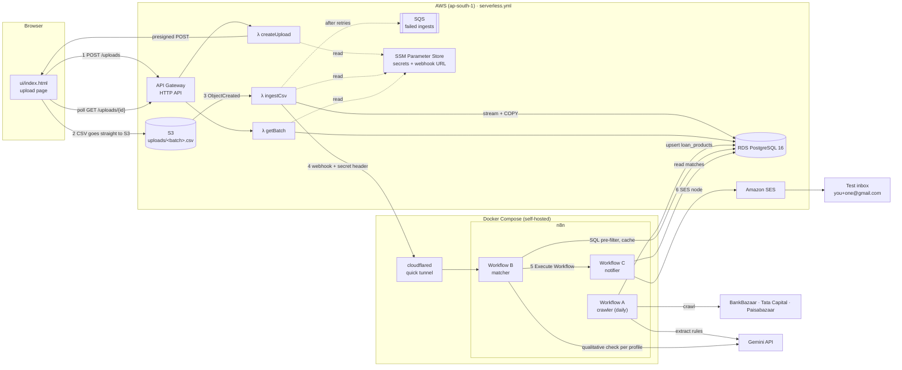

# Loan Eligibility Engine

Upload a CSV of users → they are stored in Postgres → matched against personal-loan products crawled from public websites → each matched user gets a personalised email.

The AWS side (S3, Lambda, API Gateway, RDS, SES) is deployed with the **Serverless Framework**. The business logic runs in a self-hosted **n8n** instance in **Docker Compose**, in three workflows: crawler, matcher and notifier. **Google Gemini** handles the two tasks that need language understanding: reading loan web pages, and judging qualitative eligibility rules.

---

## Architecture



**Request path for one upload:**

1. The page asks `POST /uploads` for a batch id. The `createUpload` Lambda inserts an `upload_batches` row (`pending`) and returns a **presigned S3 POST**. Unlike a presigned PUT, a presigned POST lets S3 itself enforce the file type and a 200 MB size cap.
2. The browser uploads the CSV **directly to S3**. It never passes through API Gateway (10 MB payload limit, 30 s timeout) or a Lambda.
3. The S3 `ObjectCreated` event starts `ingestCsv`. It streams the file line by line, validates every row, `COPY`s valid rows into a staging table in 5,000-row chunks, then upserts them into `users` in one statement. Memory use stays flat for any file size. Rejected rows are written to `s3://…/rejects/<batch>.csv` with a reason.
4. `ingestCsv` calls Workflow B's webhook through the tunnel, authenticated with a shared-secret header.
5. Workflow B matches the batch, then starts Workflow C.
6. Workflow C emails each matched user through SES.

The page polls `GET /uploads/{id}` and shows each stage with its numbers.

---

## Repository layout

| Path | What it is |
|---|---|
| `serverless.yml` | All AWS resources: 3 Lambdas, HTTP API, S3 bucket + trigger, SQS failure queue, RDS, security group, send-only IAM user for SES |
| `docker-compose.yml` | n8n, a Cloudflare quick tunnel, and an optional local Postgres |
| `n8n/workflows/*.json` | Workflows A, B and C, exported from n8n |
| `db/01_schema.sql` | Database schema, including the `profile_key()` function used by the matcher |
| `lambdas/loan_engine/` | Python 3.12 Lambda code: `api.py` (upload + status), `ingest.py` (CSV → Postgres), `csv_rows.py` (validation), `db.py`, `config.py`, `n8n.py` |
| `tests/` | Unit tests for CSV parsing and validation (`pytest`) |
| `ui/index.html` | The upload page: a single file with no build step |
| `scripts/` | Setup and deployment scripts (see below) |
| `data/sample_users.csv` | The 10,000-user sample from the assignment |

---

## Setup & deployment

### Prerequisites

- An AWS account and AWS CLI v2, logged in (`aws sts get-caller-identity` works)
- Docker Desktop, Node.js 18+, Python 3.12, and Git Bash on Windows
- A free Gemini API key from <https://aistudio.google.com/apikey>
- A Gmail address you control (for SES and the test inboxes)

### 1. Configure `.env`

```bash
cp .env.example .env
```

Fill in `GEMINI_API_KEY`, `SES_FROM_EMAIL` (your Gmail) and `TEST_INBOX_ALIASES`, for example `yourname+one@gmail.com,yourname+two@gmail.com,yourname+three@gmail.com`. Every other secret is generated by the scripts.

### 2. Deploy the AWS stack

```bash
npm install
python -m venv .venv && .venv/Scripts/pip install pg8000==1.31.2 boto3 pytest   # (Linux/macOS: .venv/bin/pip)
bash scripts/deploy.sh
```

`deploy.sh` runs these steps, each a separate script you can re-run on its own:

| Step | Script | What it does |
|---|---|---|
| 1 | `setup-aws-params.sh` | Generates the DB password and the webhook secret, and stores them in SSM Parameter Store as SecureStrings |
| 2 | `build-lambda-layer.sh` | Builds the `pg8000` layer for Linux arm64 and downloads the Amazon RDS CA bundle |
| 3 | `npx serverless deploy` | Creates the CloudFormation stack (RDS takes about 8 minutes the first time) |
| 4 | `init-rds.sh` | Writes the RDS endpoint into `.env` and creates the schema (psql runs in Docker) |
| 5 | `setup-ses.sh` | Requests SES verification for the sender and each test alias, and creates an access key for the send-only IAM user |
| 6 | — | Writes `ui/config.js` with the API URL |

**Click the verification link** in each email from AWS. In the SES sandbox, both the sender and every recipient must be verified.

### 3. Start n8n and load the workflows

```bash
docker compose up -d
bash scripts/n8n-bootstrap.sh       # credentials + workflows into n8n, workflows published
bash scripts/publish-tunnel-url.sh  # tells the Lambda where Workflow B's webhook is
```

Open <http://localhost:5678> and log in with `N8N_OWNER_EMAIL` / `N8N_OWNER_PASSWORD` from `.env`.

> Free Cloudflare quick tunnels expire after a few hours, and their URL changes on every restart. `publish-tunnel-url.sh` restarts the tunnel, saves the new URL to SSM and checks that it reaches n8n. Run it after `docker compose up` and before a demo. The Lambda reads the URL from SSM, so no redeploy is needed.

### 4. Run it

1. In n8n, open **A · Loan Product Discovery** and click **Execute workflow** to fill `loan_products` (it also runs daily at 06:00).
2. Open `ui/index.html` in a browser, choose `data/sample_users.csv` and click **Upload & run pipeline**.
3. Watch the stages complete, then check the test inbox.

### How credentials are configured in n8n

`n8n-bootstrap.sh` creates four credentials from `.env` through `n8n import:credentials`. n8n encrypts them with `N8N_ENCRYPTION_KEY`, and the temporary file is deleted. The workflow JSON files reference them by fixed IDs, so nothing needs re-linking after import. To set them up by hand in **Credentials → Add credential** instead:

| Credential (type) | Used by | Fields |
|---|---|---|
| **Loan Engine Postgres (RDS)** (*Postgres*) | all Postgres nodes | Host = RDS endpoint (`DB_HOST`), Database `loan_engine`, User `loan_admin`, Password = `DB_PASSWORD`, SSL = **require**. The RDS CA is trusted through `NODE_EXTRA_CA_CERTS`, so certificates stay verified. |
| **AWS SES sender** (*AWS*) | "Send via AWS SES" | Region `ap-south-1`, Access Key ID and Secret = `SES_ACCESS_KEY_ID` / `SES_SECRET_ACCESS_KEY`. This IAM user can only call `ses:SendEmail`. |
| **Gemini API key** (*Header Auth*) | both Gemini HTTP nodes | Name `x-goog-api-key`, Value = your Gemini key |
| **Ingest webhook secret** (*Header Auth*) | Workflow B's webhook | Name `X-Webhook-Secret`, Value = `N8N_WEBHOOK_SECRET`. Requests without it get 403. |

Non-secret settings (`GEMINI_MODEL`, default `gemini-flash-lite-latest`, which is available on new free-tier keys; `SES_FROM_EMAIL`, `TEST_INBOX_ALIASES`, `MAX_EMAILS_PER_RUN`, `LLM_DELAY_SECONDS`) are passed to n8n as `APP_*` environment variables and read with `$env`.

### Running without AWS (local only)

```bash
docker compose --profile local-db up -d
USE_LOCAL_DB=1 bash scripts/n8n-bootstrap.sh
```

The local Postgres container is the same engine with the same schema, on host port 55432.

### Tests

```bash
.venv/Scripts/python -m pytest
```

### Tear down

```bash
npx serverless remove --region ap-south-1     # deletes RDS, S3 contents must be emptied first
docker compose down
```

---

## Design decisions

### Ingestion: event-driven, streaming, idempotent

- **Presigned POST → S3 → event → Lambda** keeps large files away from API Gateway and Lambda payload limits. The API Lambdas only exchange small JSON.
- **Streaming + chunked `COPY`**: the ingest Lambda never holds the whole file in memory. The 10,000-row sample loads in about 2 s, and much larger files only add `COPY` chunks.
- **Idempotent**: S3 can deliver an event twice. The Lambda atomically claims the batch (`pending|failed → processing`), so a duplicate event is ignored. Users are upserted on `user_id`, and when a file repeats a user, the last row wins.
- **Failure handling**: a malformed file (for example, a missing column) fails the batch with a readable message and is not retried. Unexpected errors are retried twice by Lambda, then the event goes to an SQS failure queue. If n8n can't be reached, the users stay stored and the batch shows the error.
- **Secrets** (DB password, webhook secret) live in SSM Parameter Store. CloudFormation resolves the DB password with `{{resolve:ssm-secure:…}}`, so it never appears in the template, and the Lambdas read secrets at runtime. Lambda → RDS uses TLS with full certificate verification against the RDS CA bundle.
- **Trade-off**: the Lambdas run outside a VPC, so they can reach n8n over the internet without a NAT gateway (about $32/month). The cost is that RDS must accept connections from the internet (TLS-only, strong generated password). In production, I'd put the Lambdas and RDS in private subnets and give n8n a private route (VPN or n8n on ECS).

### Workflow A: crawling strategy

- **Sources**: BankBazaar is crawled **two levels deep**. Its rate-comparison page gives a table of bank rates and links to about 20 per-bank *eligibility* pages, which are followed. Tata Capital's own product page adds a lender-direct source, and Paisabazaar's marketplace page adds generic market criteria.
- **Link discovery, not a hard-coded list**: the HTML node selects `a[href*="personal-loan-eligibility-calculator"]`, so a new bank added to BankBazaar is picked up automatically.
- **Content hashing**: each page's cleaned text is hashed with SHA-256 (Crypto node) and compared with `source_pages.content_hash`. Unchanged pages skip the LLM, so a typical daily run makes **zero LLM calls**.
- **LLM as a parser, with structured output**: Gemini receives the cleaned page text plus the BankBazaar rate table as a hint, and must return JSON that matches a `responseSchema`. A Code node then range-checks every field. Interest rates must be 1–60%, credit scores 300–900, and employment is restricted to the three values used in the CSV.
- **Numbers are necessary conditions**: the prompt asks for the most permissive threshold of each rule (for example, "₹25k with a salary account, ₹30k without" becomes `min_monthly_income = 25000`). The stricter variants go into `eligibility_notes`. This way the SQL filter never wrongly excludes anyone, and the LLM handles the nuance.
- **Lifecycle**: products a page no longer lists are deactivated straight away. Products no crawl has seen for 7 days are retired, so users are never matched to a loan that has disappeared.

### Workflow B: the Optimization Treasure Hunt

The naive approach asks the LLM about every user–product pair: 10,000 users × ~20 products = **~200,000 LLM calls**. This pipeline makes about **one LLM call per product that has qualitative rules**, and that number doesn't grow with the number of users.

| Stage | Where | What it does | Cost |
|---|---|---|---|
| **0. Compile rules at crawl time** | Workflow A | The LLM reads each page once and turns its rules into SQL-able columns | ~1 call per changed page, per day |
| **1. SQL pre-filter** | one Postgres query | Joins the batch's users with all active products on income, score range, age range and employment, as one set-based query. Products with no qualitative notes are matched **right here**. | milliseconds, 0 LLM calls |
| **2. Profile grouping + cache** | Postgres + Code | Remaining pairs are grouped by `profile_key` = employment · income band · score band. There are at most 45 profiles, whether the batch has 10 users or 10 million. Groups that already have a cached verdict (`llm_decisions`) are skipped. | 0 LLM calls |
| **3. LLM judgement** | Gemini, one request per product | Gets all of a product's uncached profiles in **one** prompt. The LLM only judges the qualitative rules, is told that unknown facts (employer, salary account) are not grounds for rejection, and returns structured verdicts with a customer-facing reason. | ≤ 1 call per product with notes |
| **4. Expand** | Postgres | Verdicts are joined back to the individual users in SQL | milliseconds |

Further details:

- **Caching across uploads**: verdicts are keyed by `(product, profile, md5(eligibility_notes))`. A second upload with similar users makes no LLM calls. When a crawl changes a product's wording, the md5 changes and its old verdicts are ignored automatically.
- **Data stays in the database**: n8n only handles the ≤ 45 profile groups per product, never the 10,000 × 20 pairs. Candidates are kept in a `match_candidates` table between stages.
- **Fail closed**: if an LLM call fails, nothing is cached and no match is created for those profiles. The next run retries them.
- **Each run's numbers** (pairs total → after SQL → profile groups → LLM calls → matches) are saved in `upload_batches.stats` and shown on the upload page.

### Workflow C: notification

- One email per user, listing their matched products sorted by interest rate, each with the reason it fits (from the SQL rule or the LLM verdict).
- **Safety**: recipients are always rewritten to `TEST_INBOX_ALIASES`; the CSV's addresses are never used. `MAX_EMAILS_PER_RUN` caps sends, since the SES sandbox allows 200 a day at 1 per second, and a 1-second Wait sits between sends.
- **Deliverability note**: in this demo the sender is a Gmail address verified in SES. Because the message is sent by Amazon's servers rather than Google's, it fails Gmail's DMARC alignment check and Gmail puts it in Spam (a "Never send to Spam" filter on the test aliases fixes this for the demo). In production, the sender would be a domain identity such as `alerts@yourcompany.com`, verified in SES with DKIM, SPF and a custom MAIL FROM domain, and the account would be moved out of the SES sandbox.
- `notified_at` is set only after SES accepts the message (the SES node's error output skips it), so a failed send is retried next time. Each user is emailed only once per product.

---

## Data model

`upload_batches` (status + per-stage stats) · `users` · `source_pages` (crawl hash) · `loan_products` (numeric criteria + `eligibility_notes`) · `match_candidates` (temporary, between stages) · `llm_decisions` (verdict cache) · `matches` (`match_stage` = `rules` | `llm`, `reason`, `notified_at`). See [db/01_schema.sql](db/01_schema.sql).
